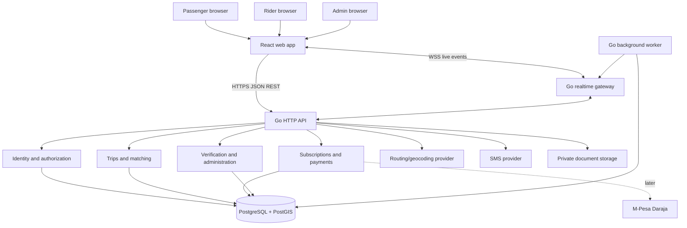
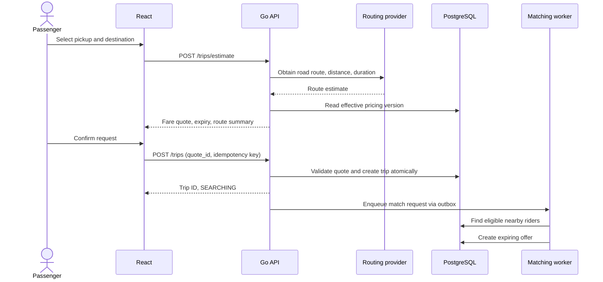
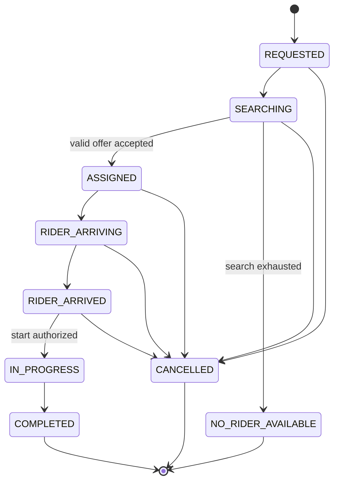

# Rider — System Architecture

**Document:** `ARCHITECTURE.md`  
**Version:** 1.0 (proposed)  
**Date:** 26 October 2026  
**Status:** Architecture proposal; implementation not started  
**Related document:** Rider PRD v1.0

## 1. Purpose and architectural principles

Rider is a web-first motorbike ride-hailing marketplace. Passengers request rides, eligible motorbike operators receive offers, and administrators oversee operations. Rider's commercial intent is subscription-based access for operators with no platform commission deducted from trip fares.

This document specifies a buildable technical architecture, not a claim that any component already exists. Business decisions intentionally **deferred**: subscription prices and durations, pilot geography, fare rates and adjustments, and final rider verification/legal requirements. These must be configurable or isolated behind policies rather than embedded in application code.

**Principles:** modular monolith first; backend as source of truth; explicit state transitions; safe concurrent assignment; least privilege; privacy by design; observable operations; mobile-ready APIs; minimal infrastructure until justified by load.

## 2. Scope and architectural decisions

| Area | Decision | Rationale |
|---|---|---|
| Web client | React + JavaScript + Vite | Familiar stack, responsive web-first MVP |
| Styling | Plain CSS with shared design tokens/components | Simple, controllable, maintainable |
| Backend | Go with standard `net/http` and explicit modules | Low dependency footprint; clear business boundaries |
| API | JSON REST under `/api/v1` | Easy for web and later mobile clients |
| Live events | Authenticated WebSockets plus REST state recovery | Timely updates without treating sockets as truth |
| Database | PostgreSQL + PostGIS | Transactions, relational integrity, geospatial queries |
| Data access | `pgx` with SQL migrations and parameterized queries | Explicit, testable queries |
| Authentication | Server-side sessions, opaque tokens in secure HttpOnly cookies | Revocable browser sessions |
| Routing/maps | Provider adapter for geocoding, routing, maps | Avoid vendor lock-in |
| Payments | Cash recording in MVP; M-Pesa adapter later | Limit initial payment complexity |
| Architecture style | Modular monolith, background worker in same codebase | Simpler deployment, separable boundaries |
| Deployment | Dockerized services, managed Postgres preferred | Repeatable releases and safer data operations |

**Not initially required:** Kubernetes, Kafka, Redis, microservices, separate passenger/rider web repositories, surge pricing, native apps. Add infrastructure only when measurements justify it.

## 3. Context and component diagram



**Trust boundaries:** browsers and external providers are untrusted; only the backend authorizes changes and computes authoritative fares, eligibility, trip assignment, and payment status. All provider callbacks are verified and idempotently processed.

## 4. Repository layout

```text
rider/
├── frontend/
│   ├── public/
│   ├── src/
│   │   ├── app/                 # router, providers, entry point
│   │   ├── components/          # shared accessible UI components
│   │   ├── features/
│   │   │   ├── auth/
│   │   │   ├── passenger/
│   │   │   ├── rider/
│   │   │   ├── trips/
│   │   │   ├── subscriptions/
│   │   │   ├── safety/
│   │   │   └── admin/
│   │   ├── services/            # API and WebSocket clients
│   │   ├── hooks/
│   │   ├── styles/
│   │   └── utils/
│   ├── package.json
│   └── vite.config.js
├── backend/
│   ├── cmd/
│   │   ├── api/main.go
│   │   └── worker/main.go
│   ├── internal/
│   │   ├── config/
│   │   ├── http/                 # router, middleware, handlers
│   │   ├── auth/
│   │   ├── users/
│   │   ├── riders/
│   │   ├── verification/
│   │   ├── locations/
│   │   ├── pricing/
│   │   ├── matching/
│   │   ├── trips/
│   │   ├── subscriptions/
│   │   ├── payments/
│   │   ├── safety/
│   │   ├── admin/
│   │   ├── realtime/
│   │   ├── notifications/
│   │   ├── providers/           # routing, SMS, storage, M-Pesa
│   │   └── platform/            # database, logs, metrics, clock
│   ├── migrations/
│   ├── tests/
│   ├── go.mod
│   └── Dockerfile
├── docs/
│   ├── PRD.md
│   ├── ARCHITECTURE.md
│   ├── DATABASE.md              # later: full schema
│   ├── API.md                   # later: request/response contracts
│   ├── SECURITY.md
│   ├── TEST_PLAN.md
│   ├── TASKS.md
│   └── DECISIONS.md
├── deploy/
│   ├── compose.yaml
│   └── nginx/                    # optional reverse proxy
├── .github/workflows/
├── .env.example                 # never include secrets
└── README.md
```

**Module rule:** HTTP handlers parse and validate requests; application services enforce use cases and authorization; repositories perform persistence; adapters integrate external systems. Do not import one module's database internals into another module. Cross-module coordination occurs through explicit services and transaction boundaries.

## 5. Main domains and responsibilities

| Domain | Owns | Key invariants |
|---|---|---|
| Identity | accounts, sessions, roles | No cross-account data access |
| Rider operations | profiles, motorbikes, availability | Only eligible riders can go available |
| Verification | documents, reviews, statuses | Only approved riders receive offers |
| Locations | consented position, timestamp, freshness | Stale riders are excluded |
| Pricing | versioned pricing policies and quotes | Server controls quoted fare |
| Matching | candidate selection and offers | One accepted rider per trip |
| Trips | booking state, transitions, events | Valid transitions only |
| Subscriptions | plans, entitlements, expiry | Expiry blocks new offers, not active trip completion |
| Payments | cash records, later provider transactions | No duplicate payment application |
| Safety | incident reports, escalation history | Restricted access, preserved evidence |
| Administration | operations, policy changes, audit | Least privilege and traceability |
| Notifications | in-app delivery and later SMS | Delivery failure never silently changes trip state |

### Domain policy interfaces

Keep pending business choices behind replaceable interfaces:

```go
type FarePolicy interface {
    Quote(ctx context.Context, route RouteEstimate, at time.Time) (FareQuote, error)
}
type RiderEligibilityPolicy interface {
    CanReceiveOffer(ctx context.Context, riderID string, at time.Time) (bool, error)
}
type VerificationPolicy interface {
    RequiredDocuments(ctx context.Context, jurisdiction string) ([]DocumentRequirement, error)
}
```

Subscription plans and fare policies are database-configured, versioned and effective-dated. Pilot service areas are configuration/data, not compile-time constants. Policy changes require authorized administration and audit trails.

## 6. Logical data model

Use UUID primary keys, `timestamptz` for event times, and PostgreSQL constraints. A separate `DATABASE.md` will provide exact DDL and indexes.

| Table | Essential fields / relationships |
|---|---|
| `users` | id, phone, phone_verified_at, status, created_at |
| `credentials` | user_id, password_hash (if passwords enabled) |
| `sessions` | id, user_id, token_hash, expires_at, revoked_at |
| `passenger_profiles` | user_id, display_name |
| `rider_profiles` | user_id, verification_status, account_status |
| `motorbikes` | id, rider_id, plate_number, status |
| `verification_documents` | id, rider_id, type, private_object_key, status |
| `verification_reviews` | id, rider_id, reviewer_id, decision, reason, created_at |
| `rider_locations` | rider_id, geography(Point,4326), observed_at, received_at |
| `rider_presence` | rider_id, desired_online, last_heartbeat_at, current_trip_id |
| `pricing_rules` | id, version, effective_from, effective_to, parameters |
| `fare_quotes` | id, passenger_id, route snapshot, price_minor, currency, pricing_rule_id, expires_at |
| `trips` | id, passenger_id, rider_id nullable, quote_id, state, fare_minor, currency, timestamps |
| `trip_offers` | id, trip_id, rider_id, status, expires_at, responded_at |
| `trip_events` | id, trip_id, actor_id, event_type, from_state, to_state, occurred_at |
| `subscription_plans` | id, duration, price_minor, currency, active |
| `rider_subscriptions` | id, rider_id, plan_id, starts_at, expires_at, status |
| `subscription_payments` | id, subscription_id, provider_reference, amount_minor, status |
| `trip_payments` | id, trip_id, method, amount_minor, status, recorded_by |
| `ratings` | id, trip_id, author_id, subject_id, score |
| `safety_reports` | id, trip_id nullable, reporter_id, category, status, restricted_notes |
| `audit_logs` | id, actor_id, action, target_type, target_id, timestamp, metadata |
| `outbox_events` | id, event_type, payload, published_at, attempts |

**Constraints and indexes:** unique normalized phone; unique verified plate where appropriate; spatial GiST index on location; `(state, created_at)` on trips; `(rider_id, status)` on offers; unique idempotency key per actor/operation; only one active trip per passenger and rider using partial unique indexes or explicit reservation rows; use transactions to enforce invariants. Location retention and precision are governed by privacy policy, not indefinite storage.

## 7. API architecture and conventions

Base path: `/api/v1`. JSON request/response. Authentication uses browser sessions; all sensitive routes require role- and resource-level authorization. Define contracts in OpenAPI before implementing handlers.

**Representative routes:**

| Method | Path | Role / purpose |
|---|---|---|
| POST | `/auth/register` | Register |
| POST | `/auth/login` | Create session |
| POST | `/auth/logout` | Revoke session |
| GET | `/auth/me` | Current account |
| POST | `/trips/estimate` | Passenger; quote based on route |
| POST | `/trips` | Passenger; create request using valid quote |
| GET | `/trips/{id}` | Authorized trip participant/admin |
| POST | `/trips/{id}/cancel` | Authorized actor |
| POST | `/trip-offers/{id}/accept` | Offered rider |
| POST | `/trip-offers/{id}/reject` | Offered rider |
| POST | `/trips/{id}/arrive` | Assigned rider |
| POST | `/trips/{id}/start` | Assigned rider; passenger confirmation rule TBD |
| POST | `/trips/{id}/complete` | Assigned rider |
| PATCH | `/rider/availability` | Eligible rider |
| POST | `/rider/location` | Rider; permissioned update |
| GET | `/rider/earnings` | Own earnings |
| GET | `/rider/subscription` | Own entitlement |
| POST | `/rider/documents` | Upload authorization workflow |
| GET | `/admin/riders` | Admin |
| POST | `/admin/riders/{id}/approve` | Authorized reviewer |
| GET | `/admin/trips` | Admin with permitted scope |
| PATCH | `/admin/pricing` | Privileged admin; versioned policy |
| GET | `/events` or `/ws` | Authenticated real-time channel |

**Conventions:** RFC 3339 UTC timestamps; opaque IDs; stable error codes; pagination for collections; explicit validation; bounded timeouts; request correlation IDs; `Idempotency-Key` on trip creation, acceptance, payment initiation and other retry-prone mutations. Prefer `409 Conflict` for state races, `403` for unauthorized actions, `422` for invalid business input, and `429` for rate limits. Never reveal sensitive rider documents or other passengers' data.

Example error envelope:

```json
{
  "error": {
    "code": "TRIP_ALREADY_ASSIGNED",
    "message": "This trip has already been assigned.",
    "request_id": "req_example"
  }
}
```

## 8. Passenger booking and fare quote sequence



**Fare quote contract:** server calculates based on route provider results and the effective policy. Persist immutable quote snapshot with expiration. No client-supplied fare or distance is authoritative. Final accepted fare is stored on the trip, with an auditable adjustment path only if policy permits. Fare amounts are stored as integer minor units with explicit currency and rounding rules.

## 9. Rider location, discovery and matching

**Location flow:** Rider explicitly enables availability and browser location permission. While the rider page is active, the client submits periodic location updates over HTTPS (or authenticated socket messages). Each update contains coordinates and observed time; server validates session, plausibility, timestamp, and rate limits. Server records receipt time and excludes stale locations. Do not claim reliable background tracking from web browsers.

**Candidate search:** PostGIS `ST_DWithin` for initial radius filtering using geography coordinates (metres); rank candidates by road ETA where practical, otherwise approximate proximity with a documented fallback. Require approved verification, active account, valid entitlement, online presence, fresh location and no active trip. Radius, offer timeout and retry count are configuration, not fixed policy.

**Assignment concurrency:**
1. Worker creates a short-lived offer for one eligible rider (sequential offers for MVP).
2. Rider accepts using an idempotent endpoint.
3. Backend begins a database transaction and locks the trip and relevant rider availability row (`SELECT ... FOR UPDATE`).
4. It rechecks offer expiry, trip state, rider eligibility and rider availability.
5. It atomically assigns rider, marks offer accepted, updates trip state, and inserts an outbox event.
6. Conflicting acceptances fail with a conflict response; retries return the original result when idempotency key matches.

Use the database, not WebSocket state, as the final concurrency authority. If a worker crashes, an outbox retry or reconciliation job recovers pending work.

## 10. Trip state machine



A trip service owns the transition matrix and authorization. Each transition writes a `trip_events` record in the same transaction. Cancellation after trip start is an exceptional support/safety workflow, not a casual client transition. When assigned, the passenger sees verified rider and motorbike details. An active trip must remain finishable if subscription entitlement expires mid-trip.

## 11. Real-time communication and recovery

The WebSocket gateway authenticates using the current session and subscribes clients only to authorized trip/user channels. Messages contain `event_id`, `type`, `trip_id`, `version`, and timestamp. The server publishes state changes after transaction commit via an outbox dispatcher. WebSockets are best-effort delivery; events can be duplicated or missed during disconnects.

**Client recovery:** on reconnect, fetch `GET /trips/{id}` and reconcile by version; do not rely on replayed socket events alone. Include heartbeats and disconnect handling. Online presence expires automatically without fresh heartbeats. Web browser tracking only works reliably during active, permissioned sessions; mobile background tracking is a separate future design.

## 12. Identity, sessions and authorization

- Normalize phone numbers and verify ownership using a provider or controlled test mode.
- Store password hashes with a modern password hashing algorithm if password login is selected; never store plaintext credentials.
- Issue cryptographically random opaque session tokens; store only their hashes server-side.
- Cookies: `HttpOnly`, `Secure` in production, suitable `SameSite`, short/rotated lifetimes, explicit logout/revocation.
- Protect state-changing cookie-authenticated requests against CSRF (token and/or strict origin checks).
- Define roles: passenger, rider, admin, superadmin. A person may hold multiple roles but authorization is checked per resource and action.
- Require MFA for production admin accounts; audit privileged operations.
- Keep document review access limited to authorized staff; no public document URLs.
- Rate-limit login, verification, quote, location and booking endpoints; apply abuse detection.

## 13. Subscriptions and payment boundaries

The subscription domain answers a narrow question: **may this rider receive a new offer at this moment?** It does not determine trip fare or deduct commission. Plan pricing, durations, grace periods and trial policy remain undecided. Represent entitlement with explicit start/end dates and status, with an auditable source (trial, payment, authorized adjustment).

**MVP:** admin-controlled or sandbox subscription activation and cash trip payment recording. Rider-reported cash collection is **not** independently verified platform revenue. Subscription receipts and passenger trip fares must appear in separate financial reports.

**Later M-Pesa:** isolate Daraja behind a payment-provider interface. Record pending intent; verify authenticated provider callback and transaction status; enforce unique provider transaction reference and idempotent processing; reconcile ambiguous payments. Do not activate paid entitlements based solely on an initiated STK Push. Decide merchant-of-record and settlement responsibilities before collecting trip fares centrally.

## 14. Maps, geocoding and routing

Create a provider-neutral interface for geocoding, route estimates and optional road ETA. Compare OpenStreetMap-based commercial providers and Google Maps on coverage, cost, quota, licence terms, and reliability. Public community OSM endpoints must not be assumed suitable for production volume. Apply provider timeouts, bounded retries and caching only where provider terms allow. Allow manual pickup correction and communicate unavailable routes without fabricating distances.

## 15. Security and privacy controls

**Threats:** fake accounts, unauthorized trip access, double assignment, GPS spoofing, forged payment confirmation, scraping of personal information, denial-of-service, admin misuse, leaked identity documents, and unsafe location disclosure.

**Controls:** TLS, secure sessions, CSRF protection, resource-level authorization, validated inputs, parameterized SQL, file type/size verification, private object storage, encrypted backups, strict CORS, secret management, dependency scanning, rate limiting, and security event logging. GPS plausibility checks reduce—but do not eliminate—spoofing. Avoid logging full location trails or identity document contents. Implement retention schedules, account deletion handling and lawful evidence preservation after local legal review.

Safety reporting and incident escalation are launch-critical. An SOS control must not imply automatic emergency dispatch unless that integration exists. Confirm transport, insurance, data protection, consumer and payment obligations in Kenya before a real pilot.

## 16. Background processing and resilience

Use a Go worker executable in the same repository for expiring offers, matching retries, subscription expiration checks, outbox dispatch, notification attempts, and reconciliation. Poll a transactional outbox with `FOR UPDATE SKIP LOCKED` or equivalent safe claim semantics. Workers must be idempotent and use retry/backoff with dead-letter visibility. Avoid relying on in-process goroutines for critical jobs that must survive restarts.

External provider failures must not corrupt trip state. Use circuit-breaking or bounded retries for unstable dependencies. Health checks distinguish liveness from readiness. Graceful shutdown closes new requests and drains in-flight work.

## 17. Deployment and environments

**Local:** Vite dev server, Go API, PostgreSQL/PostGIS via Docker Compose, mocked routing/SMS/payment providers as necessary. Use `.env.example` without secrets.

**Environments:** `development`, `staging`, `production` with separate credentials, data and service configuration. Staging must not contain unprotected production identity documents.

**Production starting topology:** HTTPS reverse proxy/load balancer → static React assets + Go API/WebSocket service → managed PostgreSQL/PostGIS; private object storage; independent worker process; centralized logs and metrics. Keep database inaccessible from the public internet. Use managed secrets and encrypted, tested backups. Choose hosting region and data residency after compliance and provider review.

**CI/CD:** lint → unit tests → integration tests with ephemeral PostgreSQL/PostGIS → security/dependency scans → build → deploy staging → smoke tests → manual production approval. Use additive/reversible migrations and document rollback procedures.

## 18. Observability and service objectives

Track request rate, error rate, latency (P50/P95/P99), DB pool saturation, WebSocket connections, matching duration, offer acceptance, stale rider presence, trip state conflicts, routing provider failures, payment callback anomalies, and outbox backlog. Use structured JSON logs with correlation IDs and no secrets. Alert on booking failures, assignment duplication attempts, persistent queue backlog, critical security incidents, and backup failures.

**Initial targets (to validate under measured pilot load):** normal API P95 < 500 ms excluding external-provider delay; fare quote P95 < 1 second when routing provider responds normally; at least 100 simultaneous active sessions in a defined load test. These are goals, not guarantees.

## 19. Testing plan

- **Unit:** fare rounding and minimums, entitlement eligibility, matching filters, trip transitions, authorization rules.
- **Database integration:** migrations, constraints, PostGIS radius queries, concurrent acceptances, outbox atomicity, partial unique indexes.
- **API integration:** validation, cookie/session security, CSRF, idempotency, permission boundaries, cancellation and retry semantics.
- **End-to-end:** registration → rider verification → online → quote → request → offer → accept → arrival → start → completion → payment recording → history.
- **Failure testing:** browser disconnect, stale GPS, duplicate socket events, worker crash, routing timeout, duplicate provider callback, DB restart.
- **Security:** broken object-level authorization, upload abuse, rate limits, session theft scenarios, privilege escalation, sensitive data exposure.
- **Field:** low-end Android browsers, unreliable mobile networks, inaccurate GPS, passenger/rider usability and safety response.

Pilot readiness requires working incident procedures and a legal/insurance compliance review, not merely passing automated tests.

## 20. Mobile migration strategy

Mobile apps (React Native or Flutter, decision later) will consume `/api/v1` and reuse backend trip, matching, fare, identity and subscription services. Keep API contracts client-neutral and versioned. Replace web-only session transport with a reviewed mobile authentication strategy when needed. Native apps may introduce background location permissions, push notifications, offline queues and device attestation, each requiring separate privacy and platform review. No need to rewrite the Go backend solely to add mobile clients.

## 21. Architectural decision records and open questions

| ID | Topic | Status / approach |
|---|---|---|
| ADR-001 | Modular monolith in Go | Proposed |
| ADR-002 | React + JavaScript web first | Agreed |
| ADR-003 | PostgreSQL/PostGIS | Proposed |
| ADR-004 | REST + WebSockets | Proposed |
| ADR-005 | Server-side browser sessions | Proposed |
| ADR-006 | Sequential rider offers for MVP | Proposed |
| OPEN-001 | Subscription pricing/duration/trial | Deferred by product owner |
| OPEN-002 | Pilot city and service boundary | Deferred by product owner |
| OPEN-003 | Fare values, rounding, adjustments, cancellations | Deferred by product owner |
| OPEN-004 | Required rider verification and compliance policy | Deferred by product owner |
| OPEN-005 | Map/routing and SMS providers | Evaluate before integration |
| OPEN-006 | Start-trip confirmation (PIN/QR/manual) | Define before trip flow implementation |
| OPEN-007 | Admin privileges and incident escalation | Define before pilot |
| OPEN-008 | Cash-only vs digital trip payment timing | Cash first proposed |
| OPEN-009 | Exact retention/deletion schedules | Legal/privacy review |

## 22. Implementation order and exit criteria

1. **Foundation:** repository, Go HTTP service, Vite app, Postgres/PostGIS, migrations, logging, health checks, CI. *Exit:* local stack starts with one command and tests run.
2. **Identity:** registration, sessions, roles, profiles, admin access. *Exit:* cross-role authorization tests pass.
3. **Rider onboarding:** motorbike profile, secure documents, review workflow, eligibility abstraction. *Exit:* unapproved rider cannot go online.
4. **Pricing and route quote:** map provider adapter, pickup/destination, server-generated quote. *Exit:* immutable, expiring quote tested.
5. **Trip engine:** state machine, idempotent creation, trip events. *Exit:* invalid transitions rejected.
6. **Presence and matching:** permissioned location, PostGIS search, offer worker, atomic acceptance. *Exit:* concurrent acceptance cannot double-assign.
7. **Realtime and recovery:** WebSocket updates, reconnect state fetch, stale presence handling. *Exit:* interrupted clients recover accurately.
8. **Payments, subscriptions and admin:** cash record, entitlement policies, dashboard, audit and incident reporting. *Exit:* pilot operational flows work end to end.
9. **Hardening and controlled pilot:** load, security, accessibility, field tests, compliance and safety review. *Exit:* explicit go/no-go approval.

## 23. Definition of done for architecture

Architecture is ready for implementation when the product owner accepts the modular boundaries, major technology choices and phased plan; detailed `DATABASE.md` and `API.md` are drafted; all launch-blocking policy decisions are identified; and the initial development environment can be reproduced. Deferred commercial and verification policies are **not** silently decided by engineering.

---

**End of Rider System Architecture v1.0**
