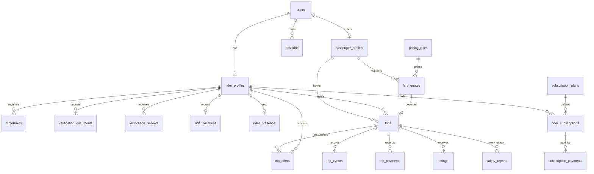

# Rider — Database Design and Data Architecture

**Document:** `DATABASE.md`  
**Version:** 1.0 (proposed)  
**Date:** 27 October 2026  
**Status:** Engineering design; not yet implemented  
**Related:** `PRD.md`, `ARCHITECTURE.md`  
**Stack:** PostgreSQL + PostGIS; Go (`pgx`), SQL migrations

> **Decision boundary:** Subscription prices/durations, pilot location/service boundaries, fare rates/adjustment rules, and final rider verification requirements are **not decided**. This schema supports configuration without silently setting those policies. The SQL below is a proposed baseline to review and split into versioned migrations, not a claim of an installed database.

## 1. Goals and principles

Rider needs reliable relational records for accounts, rider eligibility, fares, bookings, offers, subscriptions, payments, safety, and administrative actions; fast geographic discovery; and transactional protection against double assignment. PostgreSQL is the system of record. PostGIS handles proximity; a routing provider handles road distance and ETA. WebSockets are a delivery channel, not the source of truth.

- Use UUID identifiers, `timestamptz` UTC instants, `NOT NULL`/FK/CHECK constraints, and parameterized SQL.
- Store money as **integer minor units** (`bigint`) and a 3-letter ISO currency code; define rounding in pricing policy.
- Keep identity and location access limited; no public access to verification documents.
- Preserve immutable financial/event history; use explicit statuses, audit entries, and compensating adjustments rather than destructive edits.
- Use transactions for booking acceptance, trip transitions, and subscription activation.
- Start as a modular monolith; do not introduce microservices or Redis just to store online state.

## 2. Domains and ownership

| Domain | Main tables | Writes owned by |
|---|---|---|
| Identity | `users`, `credentials`, `sessions` | Auth service |
| Profiles/verification | `passenger_profiles`, `rider_profiles`, `motorbikes`, `verification_documents`, `verification_reviews` | Identity/rider services |
| Location/presence | `rider_locations`, `rider_presence`, `service_areas` | Presence service |
| Pricing | `pricing_rules`, `fare_quotes` | Pricing service |
| Trips/matching | `trips`, `trip_offers`, `trip_events`, `idempotency_keys` | Booking service |
| Subscriptions | `subscription_plans`, `rider_subscriptions`, `subscription_payments` | Subscription service |
| Fare recording | `trip_payments` | Trip payments service |
| Trust/operations | `ratings`, `safety_reports`, `audit_logs`, `outbox_events` | Trust/admin/infrastructure |

## 3. Entity relationship diagram (simplified)



**Interpretation:** Profiles use `users.id` as their primary key. A user may have passenger and rider roles; authorization is determined by profile/role plus server-side eligibility, not a browser-supplied role. Admin rights must be separately granted and audited.

## 4. Schema conventions

- PostgreSQL 16+ proposed; install a compatible PostGIS package. Verify the version offered by the deployment provider.
- `gen_random_uuid()` is available in supported modern PostgreSQL versions.
- `created_at` defaults to `now()`; `updated_at` must be maintained by the application or a documented trigger.
- Store phone numbers normalized to E.164; verify ownership in application logic.
- Use lowercase snake_case names; table plural; constraint/index names descriptive.
- Explicit `ON DELETE` actions: `RESTRICT` for trip/payment history; `CASCADE` only for genuinely disposable dependent records, after retention-policy review.
- `text` statuses are constrained by `CHECK` here to keep migrations readable; a dedicated lookup table is also acceptable for complex workflows.
- Never expose raw DB UUIDs as proof of authorization.

## 5. Foundational SQL — extensions and identity

```sql
CREATE EXTENSION IF NOT EXISTS postgis;

CREATE TABLE users (
  id uuid PRIMARY KEY DEFAULT gen_random_uuid(),
  phone_e164 text NOT NULL UNIQUE,
  phone_verified_at timestamptz,
  status text NOT NULL DEFAULT 'active'
    CHECK (status IN ('active','suspended','closed')),
  created_at timestamptz NOT NULL DEFAULT now(),
  updated_at timestamptz NOT NULL DEFAULT now(),
  CHECK (phone_e164 ~ '^\+[1-9][0-9]{1,14}$')
);

CREATE TABLE credentials (
  user_id uuid PRIMARY KEY REFERENCES users(id) ON DELETE RESTRICT,
  password_hash text NOT NULL,
  password_updated_at timestamptz NOT NULL DEFAULT now()
);

CREATE TABLE sessions (
  id uuid PRIMARY KEY DEFAULT gen_random_uuid(),
  user_id uuid NOT NULL REFERENCES users(id) ON DELETE RESTRICT,
  token_hash bytea NOT NULL UNIQUE,
  expires_at timestamptz NOT NULL,
  revoked_at timestamptz,
  created_at timestamptz NOT NULL DEFAULT now(),
  last_seen_at timestamptz,
  CHECK (expires_at > created_at)
);
CREATE INDEX sessions_user_active_idx ON sessions(user_id, expires_at)
  WHERE revoked_at IS NULL;

CREATE TABLE passenger_profiles (
  user_id uuid PRIMARY KEY REFERENCES users(id) ON DELETE RESTRICT,
  display_name text NOT NULL,
  created_at timestamptz NOT NULL DEFAULT now()
);

CREATE TABLE rider_profiles (
  user_id uuid PRIMARY KEY REFERENCES users(id) ON DELETE RESTRICT,
  display_name text NOT NULL,
  verification_status text NOT NULL DEFAULT 'pending'
    CHECK (verification_status IN ('pending','under_review','approved','rejected')),
  account_status text NOT NULL DEFAULT 'active'
    CHECK (account_status IN ('active','suspended','closed')),
  created_at timestamptz NOT NULL DEFAULT now(),
  updated_at timestamptz NOT NULL DEFAULT now()
);

CREATE TABLE motorbikes (
  id uuid PRIMARY KEY DEFAULT gen_random_uuid(),
  rider_id uuid NOT NULL REFERENCES rider_profiles(user_id) ON DELETE RESTRICT,
  plate_number text NOT NULL,
  status text NOT NULL DEFAULT 'pending'
    CHECK (status IN ('pending','approved','rejected','inactive')),
  created_at timestamptz NOT NULL DEFAULT now(),
  UNIQUE (plate_number)
);
```

**Implementation note:** Normalize plate numbers before insert. If multiple riders may operate one motorbike, replace the single `rider_id` with a separate rider–motorbike assignment table; do not assume ownership equals operation. Rider identity requirements remain a pending policy decision.

## 6. Verification and administrative roles

```sql
CREATE TABLE admin_roles (
  user_id uuid PRIMARY KEY REFERENCES users(id) ON DELETE RESTRICT,
  role text NOT NULL CHECK (role IN ('admin','super_admin')),
  granted_at timestamptz NOT NULL DEFAULT now(),
  granted_by uuid REFERENCES users(id) ON DELETE RESTRICT
);

CREATE TABLE verification_documents (
  id uuid PRIMARY KEY DEFAULT gen_random_uuid(),
  rider_id uuid NOT NULL REFERENCES rider_profiles(user_id) ON DELETE RESTRICT,
  document_type text NOT NULL,
  private_object_key text NOT NULL UNIQUE,
  status text NOT NULL DEFAULT 'submitted'
    CHECK (status IN ('submitted','accepted','rejected','expired')),
  uploaded_at timestamptz NOT NULL DEFAULT now(),
  expires_at timestamptz
);
CREATE INDEX verification_documents_rider_idx ON verification_documents(rider_id);

CREATE TABLE verification_reviews (
  id uuid PRIMARY KEY DEFAULT gen_random_uuid(),
  rider_id uuid NOT NULL REFERENCES rider_profiles(user_id) ON DELETE RESTRICT,
  reviewer_id uuid NOT NULL REFERENCES admin_roles(user_id) ON DELETE RESTRICT,
  decision text NOT NULL CHECK (decision IN ('approve','reject','request_more')),
  reason text,
  created_at timestamptz NOT NULL DEFAULT now()
);
```

Only store encrypted/private object-store references in `verification_documents`, not publicly accessible file URLs. Review access is role-restricted and logged. The exact required documents, approval workflow, and retention periods are **pending**.

## 7. PostGIS, presence, and service areas

```sql
CREATE TABLE rider_locations (
  rider_id uuid PRIMARY KEY REFERENCES rider_profiles(user_id) ON DELETE RESTRICT,
  location geography(Point,4326) NOT NULL,
  observed_at timestamptz NOT NULL,
  received_at timestamptz NOT NULL DEFAULT now(),
  accuracy_m numeric(8,2) CHECK (accuracy_m IS NULL OR accuracy_m >= 0)
);
CREATE INDEX rider_locations_gist_idx ON rider_locations USING gist(location);

CREATE TABLE rider_presence (
  rider_id uuid PRIMARY KEY REFERENCES rider_profiles(user_id) ON DELETE RESTRICT,
  desired_online boolean NOT NULL DEFAULT false,
  last_heartbeat_at timestamptz,
  current_trip_id uuid,
  updated_at timestamptz NOT NULL DEFAULT now()
);

CREATE TABLE service_areas (
  id uuid PRIMARY KEY DEFAULT gen_random_uuid(),
  name text NOT NULL,
  boundary geography(MultiPolygon,4326) NOT NULL,
  active boolean NOT NULL DEFAULT false,
  created_at timestamptz NOT NULL DEFAULT now()
);
CREATE INDEX service_areas_gist_idx ON service_areas USING gist(boundary);
```

**Coordinates:** `ST_MakePoint(longitude, latitude)`, *longitude first*. Use SRID 4326; `geography` distances are in meters. The client supplies a measured location and timestamp; the server validates coordinates, age, accuracy threshold, authenticated rider, and rate limit. Reject impossible future timestamps and excessively stale updates. A periodic cleanup policy removes old precise locations according to an approved retention schedule.

**Nearby candidates (illustrative parameterized query):**

```sql
SELECT l.rider_id,
       ST_Distance(l.location, ST_SetSRID(ST_MakePoint($1,$2),4326)::geography) AS distance_m
FROM rider_locations l
JOIN rider_presence p ON p.rider_id = l.rider_id
JOIN rider_profiles r ON r.user_id = l.rider_id
JOIN users u ON u.id = l.rider_id
WHERE p.desired_online
  AND p.current_trip_id IS NULL
  AND p.last_heartbeat_at >= now() - interval '45 seconds'
  AND l.received_at >= now() - interval '45 seconds'
  AND r.verification_status = 'approved'
  AND r.account_status = 'active'
  AND u.status = 'active'
  AND ST_DWithin(l.location, ST_SetSRID(ST_MakePoint($1,$2),4326)::geography, $3)
ORDER BY distance_m
LIMIT $4;
```

`$1` longitude, `$2` latitude, `$3` radius meters, `$4` candidate cap. **45 seconds is a technical starting threshold, not an approved service policy.** Additional eligibility checks for active subscription, approved motorbike, and geographic policy must run in the same selection/assignment workflow. Road ETA requires a routing provider; PostGIS distance is not road distance.

## 8. Configurable pricing and immutable quotes

```sql
CREATE TABLE pricing_rules (
  id uuid PRIMARY KEY DEFAULT gen_random_uuid(),
  version integer NOT NULL UNIQUE CHECK (version > 0),
  currency char(3) NOT NULL,
  base_minor bigint NOT NULL CHECK (base_minor >= 0),
  per_km_minor bigint NOT NULL CHECK (per_km_minor >= 0),
  per_minute_minor bigint NOT NULL CHECK (per_minute_minor >= 0),
  minimum_minor bigint NOT NULL CHECK (minimum_minor >= 0),
  effective_from timestamptz NOT NULL,
  effective_to timestamptz,
  created_by uuid REFERENCES admin_roles(user_id) ON DELETE RESTRICT,
  CHECK (effective_to IS NULL OR effective_to > effective_from)
);

CREATE TABLE fare_quotes (
  id uuid PRIMARY KEY DEFAULT gen_random_uuid(),
  passenger_id uuid NOT NULL REFERENCES passenger_profiles(user_id) ON DELETE RESTRICT,
  pricing_rule_id uuid NOT NULL REFERENCES pricing_rules(id) ON DELETE RESTRICT,
  pickup geography(Point,4326) NOT NULL,
  destination geography(Point,4326) NOT NULL,
  distance_m integer NOT NULL CHECK (distance_m >= 0),
  duration_s integer NOT NULL CHECK (duration_s >= 0),
  route_provider text NOT NULL,
  route_reference text,
  fare_minor bigint NOT NULL CHECK (fare_minor >= 0),
  currency char(3) NOT NULL,
  created_at timestamptz NOT NULL DEFAULT now(),
  expires_at timestamptz NOT NULL,
  CHECK (expires_at > created_at)
);
CREATE INDEX fare_quotes_passenger_idx ON fare_quotes(passenger_id, created_at DESC);
```

Do not activate a pricing rule until fare rates, currency, rounding, and effective dates are approved. The quote is generated server-side from provider route data and a versioned rule. Avoid overlapping active pricing rules for the same service area/currency by application validation plus transactional locking (or a database exclusion constraint if modeled with ranges). For multiple service areas, add an explicit `service_area_id` and enforce scoped uniqueness. Quotes must be immutable after creation.

## 9. Trips, offers, events, and assignment safety

```sql
CREATE TABLE trips (
  id uuid PRIMARY KEY DEFAULT gen_random_uuid(),
  passenger_id uuid NOT NULL REFERENCES passenger_profiles(user_id) ON DELETE RESTRICT,
  rider_id uuid REFERENCES rider_profiles(user_id) ON DELETE RESTRICT,
  motorbike_id uuid REFERENCES motorbikes(id) ON DELETE RESTRICT,
  quote_id uuid NOT NULL UNIQUE REFERENCES fare_quotes(id) ON DELETE RESTRICT,
  state text NOT NULL DEFAULT 'requested' CHECK (state IN (
    'requested','searching','assigned','rider_arriving','rider_arrived',
    'in_progress','completed','cancelled','no_rider_available')),
  fare_minor bigint NOT NULL CHECK (fare_minor >= 0),
  currency char(3) NOT NULL,
  created_at timestamptz NOT NULL DEFAULT now(),
  assigned_at timestamptz,
  started_at timestamptz,
  completed_at timestamptz,
  cancelled_at timestamptz,
  cancellation_reason text,
  updated_at timestamptz NOT NULL DEFAULT now(),
  CHECK ((rider_id IS NULL AND motorbike_id IS NULL) OR
         (rider_id IS NOT NULL AND motorbike_id IS NOT NULL))
);
CREATE INDEX trips_state_created_idx ON trips(state, created_at DESC);
CREATE INDEX trips_passenger_created_idx ON trips(passenger_id, created_at DESC);
CREATE INDEX trips_rider_created_idx ON trips(rider_id, created_at DESC);

-- An active passenger cannot have two trips, and an assigned rider cannot be double-booked.
CREATE UNIQUE INDEX trips_one_active_passenger_idx ON trips(passenger_id)
  WHERE state IN ('requested','searching','assigned','rider_arriving','rider_arrived','in_progress');
CREATE UNIQUE INDEX trips_one_active_rider_idx ON trips(rider_id)
  WHERE rider_id IS NOT NULL AND state IN ('assigned','rider_arriving','rider_arrived','in_progress');

CREATE TABLE trip_offers (
  id uuid PRIMARY KEY DEFAULT gen_random_uuid(),
  trip_id uuid NOT NULL REFERENCES trips(id) ON DELETE RESTRICT,
  rider_id uuid NOT NULL REFERENCES rider_profiles(user_id) ON DELETE RESTRICT,
  status text NOT NULL DEFAULT 'pending'
    CHECK (status IN ('pending','accepted','rejected','expired','withdrawn')),
  offered_at timestamptz NOT NULL DEFAULT now(),
  expires_at timestamptz NOT NULL,
  responded_at timestamptz,
  CHECK (expires_at > offered_at)
);
CREATE UNIQUE INDEX trip_offers_one_pending_trip_idx ON trip_offers(trip_id)
  WHERE status = 'pending';
CREATE UNIQUE INDEX trip_offers_one_accepted_trip_idx ON trip_offers(trip_id)
  WHERE status = 'accepted';
CREATE INDEX trip_offers_rider_status_idx ON trip_offers(rider_id, status, expires_at);

CREATE TABLE trip_events (
  id uuid PRIMARY KEY DEFAULT gen_random_uuid(),
  trip_id uuid NOT NULL REFERENCES trips(id) ON DELETE RESTRICT,
  actor_id uuid REFERENCES users(id) ON DELETE RESTRICT,
  event_type text NOT NULL,
  from_state text,
  to_state text,
  metadata jsonb NOT NULL DEFAULT '{}'::jsonb,
  occurred_at timestamptz NOT NULL DEFAULT now()
);
CREATE INDEX trip_events_trip_time_idx ON trip_events(trip_id, occurred_at);

ALTER TABLE rider_presence ADD CONSTRAINT rider_presence_current_trip_fk
  FOREIGN KEY (current_trip_id) REFERENCES trips(id) ON DELETE RESTRICT;
```

### Transactional acceptance algorithm

1. Begin transaction; lock trip and offer rows with `SELECT ... FOR UPDATE` in a consistent order.
2. Check offer is `pending`, unexpired, belongs to the authenticated rider, and trip is `searching`.
3. Check rider eligibility (verification, subscription entitlement, current presence/location, motorbike approval) **again**, inside the acceptance transaction; serialize against competing entitlement/assignment changes as needed.
4. Atomically update offer to `accepted`, trip to `assigned` with rider and motorbike, and rider presence `current_trip_id`.
5. Insert `trip_events` and an `outbox_events` notification in the same transaction.
6. Commit. If a unique constraint or stale-state check fails, return a conflict; if the same idempotency request is retried, return the original result.

**Concurrency invariant:** The partial unique index on active trips protects against simultaneous rider assignments even when two Go processes race. Clearing `rider_presence.current_trip_id` must happen transactionally on completion/cancellation. Prevent accepting an offer for a rider who already has another pending offer according to the chosen dispatch policy. Workers expire pending offers and retry safely.

### Trip state transitions

`requested → searching → assigned → rider_arriving → rider_arrived → in_progress → completed`; `cancelled` or `no_rider_available` are terminal alternatives at authorized stages. Invalid transitions return conflict; every successful transition writes a `trip_events` row. Cancellation after start requires a dedicated incident/support path, not a normal passenger action.

## 10. Subscriptions and payments

```sql
CREATE TABLE subscription_plans (
  id uuid PRIMARY KEY DEFAULT gen_random_uuid(),
  code text NOT NULL UNIQUE,
  display_name text NOT NULL,
  duration_days integer CHECK (duration_days IS NULL OR duration_days > 0),
  price_minor bigint CHECK (price_minor IS NULL OR price_minor >= 0),
  currency char(3),
  active boolean NOT NULL DEFAULT false,
  created_at timestamptz NOT NULL DEFAULT now(),
  CHECK ((price_minor IS NULL AND currency IS NULL) OR
         (price_minor IS NOT NULL AND currency IS NOT NULL))
);

CREATE TABLE rider_subscriptions (
  id uuid PRIMARY KEY DEFAULT gen_random_uuid(),
  rider_id uuid NOT NULL REFERENCES rider_profiles(user_id) ON DELETE RESTRICT,
  plan_id uuid REFERENCES subscription_plans(id) ON DELETE RESTRICT,
  source text NOT NULL CHECK (source IN ('trial','payment','admin_adjustment')),
  status text NOT NULL CHECK (status IN ('pending','active','expired','cancelled','suspended')),
  starts_at timestamptz NOT NULL,
  expires_at timestamptz NOT NULL,
  created_at timestamptz NOT NULL DEFAULT now(),
  CHECK (expires_at > starts_at)
);
CREATE INDEX rider_subscriptions_eligibility_idx
  ON rider_subscriptions(rider_id, status, starts_at, expires_at);

CREATE TABLE subscription_payments (
  id uuid PRIMARY KEY DEFAULT gen_random_uuid(),
  subscription_id uuid NOT NULL REFERENCES rider_subscriptions(id) ON DELETE RESTRICT,
  provider text NOT NULL,
  provider_reference text,
  amount_minor bigint NOT NULL CHECK (amount_minor >= 0),
  currency char(3) NOT NULL,
  status text NOT NULL CHECK (status IN ('pending','confirmed','failed','reversed')),
  created_at timestamptz NOT NULL DEFAULT now(),
  confirmed_at timestamptz,
  UNIQUE (provider, provider_reference)
);

CREATE TABLE trip_payments (
  id uuid PRIMARY KEY DEFAULT gen_random_uuid(),
  trip_id uuid NOT NULL REFERENCES trips(id) ON DELETE RESTRICT,
  method text NOT NULL CHECK (method IN ('cash','mpesa')),
  amount_minor bigint NOT NULL CHECK (amount_minor >= 0),
  currency char(3) NOT NULL,
  status text NOT NULL CHECK (status IN ('pending','reported_paid','confirmed','disputed','failed')),
  recorded_by uuid REFERENCES users(id) ON DELETE RESTRICT,
  created_at timestamptz NOT NULL DEFAULT now()
);
CREATE INDEX trip_payments_trip_idx ON trip_payments(trip_id);
```

**Important:** `subscription_plans` intentionally contains no seed prices or durations. Calendar-month/year subscriptions need explicit billing-period semantics rather than assuming 30/365 days; revise the plan duration representation once policy is agreed. Production subscription activation must follow verified payment or authorized trial/admin grant. A rider with an active trip may complete it even if entitlement expires mid-trip. Avoid overlapping active entitlements using serialized subscription issuance and, if appropriate, a `tstzrange` exclusion constraint. Do not interpret `reported_paid` cash as independently confirmed money.

## 11. Ratings, safety, audit, idempotency, outbox

```sql
CREATE TABLE ratings (
  id uuid PRIMARY KEY DEFAULT gen_random_uuid(),
  trip_id uuid NOT NULL REFERENCES trips(id) ON DELETE RESTRICT,
  author_id uuid NOT NULL REFERENCES users(id) ON DELETE RESTRICT,
  subject_id uuid NOT NULL REFERENCES users(id) ON DELETE RESTRICT,
  score smallint NOT NULL CHECK (score BETWEEN 1 AND 5),
  comment text,
  created_at timestamptz NOT NULL DEFAULT now(),
  UNIQUE (trip_id, author_id, subject_id),
  CHECK (author_id <> subject_id)
);

CREATE TABLE safety_reports (
  id uuid PRIMARY KEY DEFAULT gen_random_uuid(),
  trip_id uuid REFERENCES trips(id) ON DELETE RESTRICT,
  reporter_id uuid NOT NULL REFERENCES users(id) ON DELETE RESTRICT,
  category text NOT NULL,
  status text NOT NULL DEFAULT 'open'
    CHECK (status IN ('open','investigating','resolved','closed')),
  restricted_notes text,
  created_at timestamptz NOT NULL DEFAULT now(),
  updated_at timestamptz NOT NULL DEFAULT now()
);

CREATE TABLE audit_logs (
  id uuid PRIMARY KEY DEFAULT gen_random_uuid(),
  actor_id uuid REFERENCES users(id) ON DELETE RESTRICT,
  action text NOT NULL,
  target_type text NOT NULL,
  target_id uuid,
  metadata jsonb NOT NULL DEFAULT '{}'::jsonb,
  occurred_at timestamptz NOT NULL DEFAULT now()
);
CREATE INDEX audit_logs_occurred_idx ON audit_logs(occurred_at DESC);

CREATE TABLE idempotency_keys (
  actor_id uuid NOT NULL REFERENCES users(id) ON DELETE RESTRICT,
  operation text NOT NULL,
  key text NOT NULL,
  request_hash bytea NOT NULL,
  response_status integer,
  response_body jsonb,
  created_at timestamptz NOT NULL DEFAULT now(),
  expires_at timestamptz NOT NULL,
  PRIMARY KEY (actor_id, operation, key)
);

CREATE TABLE outbox_events (
  id uuid PRIMARY KEY DEFAULT gen_random_uuid(),
  event_type text NOT NULL,
  aggregate_id uuid NOT NULL,
  payload jsonb NOT NULL,
  attempts integer NOT NULL DEFAULT 0 CHECK (attempts >= 0),
  available_at timestamptz NOT NULL DEFAULT now(),
  published_at timestamptz,
  last_error text,
  created_at timestamptz NOT NULL DEFAULT now()
);
CREATE INDEX outbox_pending_idx ON outbox_events(available_at, created_at)
  WHERE published_at IS NULL;
```

Idempotency keys are scoped by actor + operation; identical retries return the stored result, while reuse with different payload is rejected. Outbox workers claim work using `FOR UPDATE SKIP LOCKED`, retry with backoff, and expose permanently failed jobs. Consumers must also deduplicate events. Safety reports and audit logs require strict access control; do not put personal or secret data into unrestricted JSON metadata.

## 12. Access controls and privacy

- Go API connects using a least-privilege application DB role; migrations use a separate owner role. Never connect the public frontend directly to PostgreSQL.
- Application authorization enforces passenger/rider/admin ownership on every read and write. Consider PostgreSQL RLS as defense in depth only after defining transaction-safe session identity and tests; do not assume RLS is already active.
- Protect exact rider coordinates, verification documents, and incident notes; expose only necessary fields and time windows.
- Use TLS for database connections where appropriate, encryption at rest, secret management, access logging, and restricted backup access.
- Define retention/deletion policies with Kenyan legal review; do not invent retention periods. Account closure may require anonymization and restricted retention of financial/safety evidence.
- Never log passwords, raw session tokens, OTPs, full ID documents, or complete payment credentials.

## 13. Index and query strategy

Spatial GiST index enables radius searches; B-tree indexes serve recent trip histories and eligibility. Test with `EXPLAIN (ANALYZE, BUFFERS)` using representative synthetic datasets. Avoid adding speculative indexes: every index increases write and storage cost. Consider partial indexes for active states, pagination by `(created_at, id)`, and batched inserts for noncritical events. `ST_DWithin` with geography and a GiST index is preferable to manually computing lat/lon bounding boxes for nearby candidates.

## 14. Migrations, environments, and seeds

Suggested layout:

```text
backend/
  migrations/
    000001_extensions_and_identity.up.sql
    000001_extensions_and_identity.down.sql
    000002_profiles_and_verification.up.sql
    000003_presence_and_geography.up.sql
    000004_pricing_and_trips.up.sql
    000005_subscriptions_and_payments.up.sql
    000006_safety_audit_outbox.up.sql
  internal/
    database/
      pool.go
      tx.go
      queries/
```

Migrations run in CI/staging before release and are version tracked. Destructive down migrations must never be run automatically against production. Use separate development, test, staging, and production databases. Seed only synthetic demo accounts and inert placeholder plan records; **do not seed invented live pricing, pilot polygons, or verification approvals**. Enable PostGIS before tables that use geography. The displayed DDL should be split by dependency order; `rider_presence` FK to trips is intentionally added after trip creation.

## 15. Backup and recovery

Use automated encrypted backups, restricted credentials, tested point-in-time recovery where supported, and documented restoration drills. Define recovery point/time objectives before launch based on actual operational tolerance. Verify backups by restoring to an isolated environment; backup success alone does not prove recoverability.

## 16. Testing checklist

- [ ] Schema migration applies cleanly to a fresh PostgreSQL/PostGIS instance.
- [ ] All FKs, CHECKs, unique constraints and partial indexes behave as intended.
- [ ] Phone normalization and duplicate handling tested.
- [ ] Spatial radius query returns expected results (meters, longitude/latitude order).
- [ ] Stale location and offline riders are excluded.
- [ ] Ineligible/expired-subscription riders cannot accept a new trip.
- [ ] Two concurrent acceptances cannot assign one trip twice.
- [ ] One rider cannot hold two active trips; one passenger cannot book two active trips.
- [ ] Duplicate `Idempotency-Key` does not create extra bookings or charges.
- [ ] Quote expiry and pricing version snapshot enforced.
- [ ] Invalid trip state transitions fail; every valid transition records an event.
- [ ] Outbox event survives API process crash and is retried safely.
- [ ] Cash reported-paid is distinguishable from confirmed payment.
- [ ] Unauthorized users cannot view others' trips, exact locations, documents or safety reports.
- [ ] Backup restoration works; schema and data integrity are verified.

## 17. Implementation order and dependencies

1. Provision PostgreSQL/PostGIS; create DB roles and migration runner.
2. Identity, sessions, profiles, and authorization foundations.
3. Rider verification schema and admin approval workflow (policy fields remain configurable).
4. Rider presence and geospatial candidate search.
5. Versioned pricing rules and immutable quotes (activate only after pricing decision).
6. Trip state machine, offers, transactional assignment, events and outbox.
7. Subscriptions/entitlements and cash trip recording.
8. Ratings, safety reporting, audit trails and admin queries.
9. Load, race, privacy, backup and recovery tests before pilot.

## 18. Pending decisions and schema change triggers

| Decision | Status | Schema impact |
|---|---|---|
| Subscription price and period | Pending | Plan price and billing-period representation; no production seed values |
| Pilot geography | Pending | Service-area polygons, geofenced eligibility, pricing scope |
| Fare policy | Pending | Rate values, rounding, adjustments, cancellation rules, quote expiration |
| Rider verification policy | Pending | Document categories, expiry checks, reviewer workflow, retention |
| Cash vs live M-Pesa at pilot | Cash-first proposed | Provider callbacks, reconciliation and reversal tables if live payments enabled |
| Single rider per motorbike | Assumption to validate | May require assignment history/junction table |
| Rider location freshness threshold | Technical default only | Matching eligibility and heartbeat expiry |
| Subscription overlap and renewals | Pending | Exclusion constraints, scheduled renewals, grace-period rules |

## 19. Review and definition of done

This design is approved when engineering and product owners confirm: entity relationships; booking and entitlement invariants; PII boundaries; migration strategy; transactional race protection; retention decisions requiring legal input; and the explicit unresolved business policies. Approval of this document **does not** approve pricing, pilot geography, legal eligibility, or a production launch.

---

**End of Rider `DATABASE.md` v1.0**
