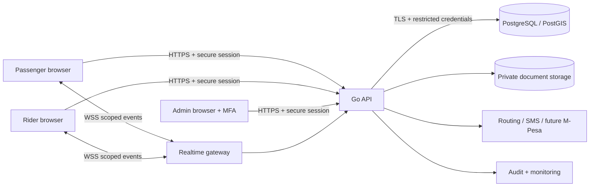

# Rider — Security Architecture, Threat Model, and Controls

**Version:** 1.0 (draft)  
**Updated:** 28 October 2026  
**Status:** Engineering baseline; requires review before any real-world pilot  
**Related:** `PRD.md`, `ARCHITECTURE.md`, `DATABASE.md`, `API.md`  
**System:** React + JavaScript/Vite web client; Go modular-monolith API; PostgreSQL + PostGIS; WebSockets; external routing, messaging and later M-Pesa providers.

> **Purpose:** Define testable security and privacy requirements for Rider's passenger, motorbike-operator, and administrative experiences. This document is a design specification, not a certification of security or Kenyan legal compliance. It does **not** decide subscription prices, pilot location, fare policy, or the final rider verification policy. Those remain open and configurable.

## 1. Security objectives and non-negotiable principles

1. **Protect people first:** Prevent unauthorized disclosure of live or historical passenger/rider locations and sensitive identity documents; make safety incidents actionable.
2. **Server is authoritative:** Never trust frontend-supplied user IDs, prices, roles, eligibility, trip state, payment success, or location claims without appropriate validation.
3. **Least privilege and separation of duties:** Limit data and operations by actor, purpose, and account status. Require stronger controls for administrators.
4. **Secure by default:** Deny access when authorization, entitlement, freshness, or verification checks fail; handle service failures safely.
5. **Defense in depth:** Layer authentication, authorization, validation, transaction constraints, rate limiting, monitoring, and recovery.
6. **Data minimization:** Collect only necessary personal data; define purpose, access, retention, and deletion before collection.
7. **Auditable state changes:** Preserve immutable or append-only evidence for sensitive decisions, payments, and trip transitions without logging secrets.
8. **Mobile-ready APIs:** Keep security rules in the Go backend so later mobile clients cannot bypass them.

**Launch gates:** No live pilot with unreviewed transport/insurance/identity requirements, untested incident response, missing backups, missing TLS, or critical/high-risk vulnerabilities without documented mitigation and approval.

## 2. System boundaries and trust model

**Trust boundaries:** public internet → reverse proxy → API; user session → privileged business action; API → database/storage; API → third-party provider; browser → geolocation input; real-time gateway → authorized trip channel. Each crossing requires explicit validation, credentials and/or authorization.

**Sensitive assets:** account credentials/session tokens, phone numbers, identity and licence documents, precise and historical GPS positions, trip/passenger associations, trip fares and payment records, administrator powers, audit evidence, signing keys and provider credentials.

## 3. Roles, permissions and access matrix

Roles are `passenger`, `rider`, `admin`, `super_admin`; a person may hold multiple roles, but privileges must be checked for the **active role and resource**, not merely a role string.

| Operation | Passenger | Rider | Admin | Super admin |
|---|---|---|---|---|
| View own profile and trips | Own only | Own only | Scoped support need | Scoped support need |
| Request trip / see quote | Own | No | No | No |
| Publish location / accept offer | No | Eligible own account | No | No |
| View live trip location | Own active assigned trip | Own active assigned trip | Restricted incident/support access | Restricted incident/support access |
| View verification documents | No | Own submitted docs | Authorized reviewer only | Authorized reviewer only |
| Approve/suspend riders | No | No | Authorized staff | Authorized staff |
| Change pricing or subscriptions | No | No | Explicit permission only | Explicit permission only |
| Create admins/change admin roles | No | No | No | Explicit permission only |
| View audit logs | No | No | Authorized scoped access | Authorized scoped access |

**Implementation:** deny-by-default middleware plus resource-level checks in Go services; never rely on hidden UI elements. Object ownership is verified from authenticated identity and database relations. Authorization must be rechecked on each state-changing request and on WebSocket subscriptions. Admin privileges should be granular permissions rather than unrestricted blanket access.

## 4. Threat model (initial STRIDE-style register)

| ID | Threat / abuse case | Impact | Required mitigation | Verification |
|---|---|---|---|---|
| T01 | Account takeover / credential stuffing | Unauthorized trips and PII | Rate limits, secure hashing, session revocation, MFA for admins | Auth abuse tests |
| T02 | IDOR/BOLA: reading another user's trip | Location/PII leak | Ownership checks on every resource and event | Cross-user API tests |
| T03 | Rider impersonation / fake documents | Passenger safety | Controlled onboarding, review workflow, document access controls | Verification tests + operational review |
| T04 | Fake GPS / location replay | Wrong matching, fraud | Freshness, bounds, speed/anomaly checks, flag suspicious updates; GPS is not proof of presence | Spoofing tests |
| T05 | Double trip acceptance / replay | Conflicting assignments | Atomic database transactions, unique constraints, idempotency | Concurrency tests |
| T06 | Tampered quote or trip fare | Financial disputes | Server-generated signed/opaque quote reference, immutable accepted fare and version | Price tamper tests |
| T07 | Fake payment confirmation / callback | Revenue loss | Provider signature/auth verification, reconcile server-to-server, idempotent webhook processing | Callback tests |
| T08 | CSRF against cookie-auth endpoints | Unauthorized changes | CSRF tokens and Origin checks, SameSite cookies | CSRF tests |
| T09 | XSS / malicious input | Session abuse, data leak | Context-safe rendering, CSP, input validation, no unsafe HTML | Browser security tests |
| T10 | WebSocket room guessing / stale session | Live location exposure | Authenticated handshake, per-event scope, revalidation, close on revocation | WS access tests |
| T11 | Admin abuse / bulk export | Mass PII leak | MFA, least privilege, access logging, approval for sensitive exports | Admin audit tests |
| T12 | Database or storage compromise | PII/document exposure | Network isolation, least-privilege credentials, encryption, backups, rotation | Config review |
| T13 | Denial of service / costly map API abuse | Outage, runaway spend | Layered rate limits, quotas, provider budget alerts, bounded payloads | Load/abuse tests |
| T14 | Insider access to incident reports | Retaliation/privacy harm | Case-level permissions, redaction, audit and escalation | Permission tests |
| T15 | Dependency / CI compromise | Supply-chain breach | Lockfiles, scanning, protected branches, secret scanning | Pipeline checks |

**Residual risks:** browser location spoofing cannot be fully prevented; provider outages and physical safety incidents cannot be eliminated through software alone. Document and accept residual risks explicitly before launch.

## 5. Authentication and session management

### 5.1 User sign-in

- Use a proven Go password-hashing implementation (Argon2id preferred with benchmarked parameters; bcrypt acceptable when configured appropriately). Never store plaintext or reversible passwords.
- Phone verification must prove control of the number using short-lived, single-use codes; hash verification codes at rest, limit attempts and resend frequency, and avoid account enumeration.
- Password recovery must use short-lived single-use tokens, revoke relevant sessions where appropriate, and not disclose whether an account exists.
- MFA is mandatory for administrative roles before production; prefer phishing-resistant methods where practical. Protect MFA recovery flows.
- Add rate limits per account, IP and device/network signals with privacy-conscious handling; do not create permanent lockouts that attackers can exploit against victims.

### 5.2 Browser sessions

- Prefer opaque random server-side session identifiers in cookies: `Secure`, `HttpOnly`, `SameSite=Lax` or `Strict` as compatible with flows, narrow `Path`, and no unnecessary `Domain` attribute. Use `__Host-` prefix when feasible.
- Regenerate session identifiers at login and privilege changes. Define idle and absolute expiry, logout invalidation, device/session revocation and administrative force-logout.
- Store only a hash of the session secret in the database; never log session IDs. For sensitive actions, consider step-up authentication.
- Use HTTPS for all production traffic and HSTS after confirming domain/TLS readiness. Never store session secrets in `localStorage`.

### 5.3 CSRF and CORS

- Require anti-CSRF protection on cookie-authenticated state-changing routes, including WebSocket establishment as appropriate; validate `Origin`/`Referer` with documented exceptions.
- CORS is an explicit allowlist of trusted frontend origins, not `*` with credentials. CORS is **not** an authorization mechanism.
- Cookies, CSRF and CORS settings must be verified separately in development, staging and production.

## 6. API security and request validation

- API base path `/api/v1`; JSON only for normal API routes, with strict content types and maximum body sizes.
- Validate types, lengths, enumerations, coordinates (`latitude -90..90`, `longitude -180..180`), pagination, and trip state. Reject unknown/unsupported fields where appropriate.
- Derive actor ID and role from authenticated session; ignore client-provided authoritative actor IDs.
- Use parameterized SQL queries; never interpolate user input into SQL identifiers or query text.
- Use stable error codes with safe messages; avoid returning stack traces, internal SQL, tokens, or personal information.
- Apply route-specific rate limits: login/OTP, quotes, trip creation, location updates, search, uploads and admin actions.
- Require idempotency keys for retryable high-impact operations (trip creation, acceptance where applicable, subscription payments). Scope keys by actor/route, persist request hash and result, and reject conflicting reuse.
- Restrict outbound URLs and redirects to approved providers; defend against SSRF in any backend fetch functionality.
- Set standard security headers: CSP, `X-Content-Type-Options: nosniff`, `Referrer-Policy`, sensible `Permissions-Policy`, and clickjacking protection (`frame-ancestors`).

## 7. Trip booking, matching and fare integrity

**Critical invariants:**

1. Only a passenger can request a trip for their own authenticated account.
2. Quote is generated by backend from an approved routing result and versioned pricing configuration; quote has expiry and is bound to requester, pickup/destination, currency and parameters.
3. Only verified, active, eligible, online riders with fresh location and required entitlement may receive offers.
4. Only the intended rider may accept an unexpired outstanding offer.
5. At most one accepted rider per trip, and no rider may hold incompatible simultaneous active assignments.
6. Accepting a trip is atomic in PostgreSQL; use row locking/conditional updates plus unique indexes where appropriate. Do not depend on WebSocket message order.
7. Trip state transitions follow the server-side state machine, with actor checks and append-only event history.
8. Subscription expiry during an active trip must not forcibly terminate that trip.
9. Fare accepted by both parties is recorded immutably with pricing version; adjustments require a separate authorized, auditable workflow once policy is defined.
10. Every cancellation, override and manual intervention records actor, reason and timestamp.

**Concurrency test:** Fire multiple simultaneous accept requests from distinct riders and duplicate requests from the same rider. Exactly one valid assignment must commit; other attempts receive a safe conflict/expired response.

## 8. Location security and privacy

### 8.1 Collection and accuracy

- Ask browser permission only when location is needed; offer manual pickup selection for passengers.
- Collect rider location only while they have explicitly enabled availability/tracking and while necessary for an active booking; clearly disclose the behavior.
- Store latitude/longitude as PostGIS `geography(Point,4326)` with server-received timestamp, client timestamp (untrusted), accuracy metadata where available, and freshness status.
- Reject impossible coordinates and unreasonable timestamp skew; flag suspicious jumps and implausible speed. Do not treat GPS as tamper-proof identity or location evidence.
- Only match riders with sufficiently recent updates; stale riders become unavailable. Exact freshness thresholds remain configurable.

### 8.2 Disclosure and retention

- Passengers can see only the assigned rider's location during the authorized trip window, not a map of all riders' precise positions.
- Riders receive only passenger pickup/destination and details necessary for the accepted journey, not unrelated personal history.
- Administrative access to precise historical location requires a documented operational purpose, restricted permissions and audit trail.
- Prefer short retention for raw location telemetry, with aggregated/limited trip records retained only as justified. Exact retention periods require legal/privacy review.
- Disable precise tracking when trips end or availability is off, except as required for clearly disclosed incident handling.
- Web clients cannot guarantee background GPS updates: expose last-update time and fail safely when stale.

## 9. Verification documents and file uploads

- Define required rider documents **later**, with compliance/legal input; implement a flexible document-type registry and review workflow now.
- Upload via authenticated, authorized endpoint or short-lived scoped upload URL to private object storage; no public buckets.
- Validate extension, detected MIME/type, size and allowed formats; scan for malware where feasible; reject executable or suspicious content.
- Generate random storage keys; never use user-supplied filenames as paths. Prevent path traversal and unsafe file parsing.
- Serve downloads through short-lived, authorization-checked URLs or proxy streaming with `Content-Disposition: attachment` and `nosniff`.
- Encrypt at rest using provider-managed or customer-managed keys as appropriate; separate metadata and storage permissions.
- Log reviewer, action and decision without logging document contents; implement deletion/retention schedules after policy approval.

## 10. Payments and subscriptions

### 10.1 Cash pilot

- Record cash as **rider-reported** until corroborated; do not claim independent verification.
- A completed trip is not automatically a confirmed payment. Distinguish fare, payment status and subscription revenue.
- Only the assigned rider and authorized staff can modify allowed payment states; disputes are recorded, not overwritten.

### 10.2 Future M-Pesa

- Store provider credentials in a secret manager; use HTTPS, provider-approved authentication and callback validation.
- Treat callbacks as untrusted until verified. Verify transaction identifiers, amount, currency, account reference, status and provider provenance; reconcile with provider records when supported.
- Process callbacks idempotently, retain sanitized event evidence and prevent replay/duplicate crediting.
- Do not activate subscriptions on STK initiation; only on validated successful payment.
- Keep trip fare settlement and platform subscription billing as separate ledgers and permission domains.
- Review the legal/payment implications before ever collecting passenger fares on behalf of riders.

### 10.3 Subscription entitlement

- Calculate eligibility server-side using approved verification status, account status and effective subscription/trial period.
- Check entitlement when offering and accepting trips; preserve active-trip continuity on mid-trip expiry.
- Admin manual activations/adjustments require reason, actor and audit record; consider dual approval for exceptional financial adjustments.

## 11. WebSocket and real-time security

- Only `wss://` in production; authenticate handshake with the established session and verify Origin.
- Subscribe users only to events for trips they own or are currently assigned to. Do not trust client-supplied room IDs without resource authorization.
- Revalidate access after assignment changes, cancellation, suspension and logout; disconnect/revoke unauthorized sessions promptly.
- Restrict event payloads to minimal fields; never broadcast identity documents, session tokens or precise locations to global channels.
- Limit connections, subscription counts, message sizes and publish frequency. Enforce heartbeat, idle timeouts and backpressure.
- On reconnect, fetch authoritative trip state via REST; WebSockets are notifications, not the source of truth.
- Record security-relevant disconnects/denied subscriptions without capturing sensitive payloads.

## 12. Administrative and support security

- Require MFA, separate admin login context, least-privilege permissions and short session lifetimes.
- Prevent administrators from approving their own rider verification submissions or escalating their own privileges.
- Sensitive actions (role grants, bulk exports, verification overrides, subscription credits, pricing changes) need explicit permission and audit entries; consider two-person approval based on risk.
- Support tooling must mask unnecessary personal data and show case-linked reasons for accessing sensitive records.
- Super admin is not an exemption from auditing. Audit log viewers cannot edit historical log entries.
- Define joiner/mover/leaver processes for admin accounts and rapid emergency revocation.

## 13. Data protection, Kenyan regulatory review and privacy rights

Rider must evaluate applicable Kenyan law and regulatory requirements with qualified advisers, including the **Data Protection Act, 2019** and relevant ODPC guidance, transport licensing/insurance requirements, consumer protection and payment-provider terms. Whether registration or additional approvals are required depends on the actual processing and operating model; do not infer compliance from this document.

Before pilot:

- Map personal data categories, purpose, lawful basis, recipients, processors, cross-border transfers and retention.
- Publish understandable privacy notices for passengers and riders, including precise-location and verification-document processing.
- Define access, correction, deletion and other applicable data-subject request workflows, with identity verification and legal exceptions.
- Assess whether a data protection impact assessment is required, especially for systematic location tracking and identity verification; document the decision.
- Put appropriate agreements and security checks in place with cloud, maps, SMS and payment processors.
- Document breach response and applicable notification requirements; legal counsel should confirm thresholds and deadlines.
- Define consent and alternatives where consent is the appropriate legal basis; don't bundle optional marketing into required service acceptance.

## 14. Infrastructure and deployment hardening

**Environments:** local, staging and production must have separate databases, secrets, credentials and external-provider configurations. Do not use real identity documents in development or routine tests.

- Reverse proxy/load balancer terminates TLS; enforce HTTPS, certificate renewal, trusted proxy headers and request-size/time limits.
- Database and private storage are not publicly exposed; restrict network access to app services and authorized operators.
- Run containers/processes as non-root with minimal permissions, read-only filesystem where feasible and pinned base images.
- Use a managed secret store or secure deployment secrets, never `.env` committed to Git; rotate on compromise or personnel change.
- Apply OS, Go dependency, npm and container security updates; scan dependencies and images in CI.
- Set resource limits, connection pool limits, query timeouts, request deadlines and graceful shutdown.
- Restrict outbound egress to necessary providers where practical; monitor map/SMS usage and costs.
- Use separate least-privilege DB roles for application, migration and read-only operational tasks.

## 15. Database controls and integrity

- Use parameterized SQL, explicit transactions, FK/check/unique constraints, and PostGIS GiST indexes as designed in `DATABASE.md`.
- Application DB credentials must not have superuser, `CREATEDB`, or schema-owner rights in production.
- Keep sensitive fields out of analytics exports unless explicitly required and authorized.
- Prefer soft-deletion or restricted retention where audit/legal obligations apply; do not silently erase trip/financial evidence.
- Apply encryption in transit and storage-level encryption; use field-level protection for especially sensitive values when warranted by threat assessment.
- Test point-in-time recovery and backups; backups inherit the same access and retention protections as primary data.

## 16. Logging, monitoring and detection

**Log:** request ID, actor ID (pseudonymous where practical), action, resource ID, outcome, timestamp, source context and latency; admin permission changes, failed logins, unusual location updates, booking conflicts, payment reconciliation failures and denied WebSocket subscriptions.

**Do not log:** passwords, OTPs, cookies, authorization headers, full identity documents, raw provider secrets, full precise GPS traces in generic logs, or payment credentials.

- Structured JSON logs with correlation IDs and synchronized clocks.
- Tamper-resistant audit store with restricted read access and retention policy.
- Alerts for spikes in auth failures, suspicious exports, unauthorized access attempts, repeated double-booking conflicts, stale rider-location rates, provider failures and elevated 5xx errors.
- Dashboards: availability, API p50/p95/p99, WebSocket connection health, trip assignment success, background job failures and backup status.
- Document who receives alerts and how incidents are escalated; monitoring without an owner is not sufficient.

## 17. Incident response and user safety

### 17.1 Security incident process

1. **Detect and triage:** capture time, affected services, data and potential user impact.
2. **Contain:** revoke sessions/keys, block abusive actors, disable affected integration or feature when necessary.
3. **Preserve evidence:** protect audit logs and relevant records with limited access and documented chain of custody.
4. **Eradicate and recover:** patch, restore from verified backup if necessary, rotate credentials and validate integrity.
5. **Notify:** involve designated leadership/legal/privacy responders and meet applicable obligations.
6. **Review:** record root cause, lessons learned, owner and remediation deadline.

### 17.2 Physical safety incident process

- Provide a clear in-app report mechanism and accessible support route.
- Define emergency escalation ownership and response windows before pilot.
- Preserve only necessary trip data with strict access for investigation.
- Never imply an SOS control contacts emergency services unless a real, tested integration exists.
- Make account suspension, evidence preservation and user communication policies explicit and fair.

## 18. Backup, recovery and business continuity

- Automated encrypted PostgreSQL backups; consider PITR/WAL archival for production.
- Define and approve RPO/RTO before pilot; do not invent availability guarantees.
- Regular restore drills to an isolated environment, including verification of geographic data, trip state and subscription records.
- Version and back up configuration/migrations securely; store recovery keys separately.
- Prepare degradation modes for routing outages, SMS delays, WebSocket disconnects and payment-provider downtime. Never show unconfirmed payments as successful.
- Maintain an emergency method to stop new bookings while preserving active-trip and support workflows.

## 19. Secure development lifecycle and CI/CD

- Branch protection, pull-request review where collaborators exist, and automated checks before merge.
- Automated Go unit/integration tests; React tests; linting; dependency and secret scanning; database migration checks.
- Use reproducible lockfiles, pinned toolchains and restricted CI credentials.
- Never use production data in test fixtures. Seed synthetic riders, trips and coordinates.
- Require threat-model review for new data flows, provider integrations, payments, admin powers or location-sharing features.
- Record architectural/security decisions in ADRs and link requirements to tests.
- Run periodic manual authorization testing and an independent security review before a wider public launch.

## 20. Security test matrix and acceptance criteria

| Test ID | Scenario | Expected result |
|---|---|---|
| S-001 | Anonymous user reads private trip | 401/403; no data leaked |
| S-002 | Passenger A reads passenger B's trip | 403/404 without revealing private data |
| S-003 | Rider accepts another rider's offer | Rejected; assignment unchanged |
| S-004 | Two riders accept concurrently | Exactly one succeeds; invariant preserved |
| S-005 | Replayed trip creation key | Same result or safe conflict; no duplicate trip |
| S-006 | Tampered client fare | Backend ignores/rejects altered fare |
| S-007 | Expired quote submitted | Rejected; fresh quote required |
| S-008 | Unverified/offline/stale rider receives offer | No offer issued |
| S-009 | Cross-origin CSRF on state-changing route | Rejected |
| S-010 | XSS payload in name/support note | Rendered safely, not executed |
| S-011 | WebSocket subscribe to unrelated trip | Denied; no events received |
| S-012 | Session revoked during WS connection | Connection/access revoked |
| S-013 | Invalid/oversized document upload | Rejected; nothing publicly exposed |
| S-014 | Non-admin calls admin endpoint | Denied and logged |
| S-015 | Admin without permission changes pricing | Denied and logged |
| S-016 | OTP brute-force and resend spam | Throttled; codes expire and are single-use |
| S-017 | Duplicate payment webhook | One ledger effect only |
| S-018 | Forged payment success callback | No entitlement activated |
| S-019 | Stale GPS location | Rider excluded from matching |
| S-020 | DB restore drill | Data integrity verified against approved RPO/RTO |
| S-021 | Secrets in log/error response | None exposed |
| S-022 | Subscription expires during trip | Trip continues; new offers gated |
| S-023 | Unauthorized access to verification file URL | Denied; URL short-lived |
| S-024 | Suspended account with active session | Privileged actions rejected promptly |

**Definition of done for each feature:** threat scenarios reviewed; authorization implemented server-side; positive/negative tests passing; sensitive data minimized; logging safe; operational failure behavior documented.

## 21. Prioritized implementation plan

**P0 — Before backend feature work:** session/auth framework, authorization middleware, CSRF/CORS policy, environment secrets, validation, audit event conventions, DB roles and migration controls.

**P1 — Before functional end-to-end demo:** trip/offer atomicity, fare quote integrity, location freshness, WebSocket authorization, file upload safeguards, idempotency, integration tests.

**P2 — Before real rider/passenger pilot:** phone verification, admin MFA, private document storage, rider verification workflow (policy to be approved), privacy notice and retention decision, safety escalation process, backup/restore drill, load/security tests, transport/insurance/legal review.

**P3 — Before payment automation and public expansion:** verified payment callbacks and reconciliation, stronger fraud controls, independent penetration/security review, incident tabletop exercise, operational on-call, scalability tests.

## 22. Open decisions and owners

| Decision | Status | Suggested owner / trigger |
|---|---|---|
| Subscription price and billing cadence | **Deferred** | Product/business review |
| Pilot geography | **Deferred** | Product/operations review |
| Fare rates, cancellation and adjustment policy | **Deferred** | Product/operations review |
| Exact rider document requirements and approval policy | **Deferred** | Legal/operations review before pilot |
| Phone OTP provider | Open | Engineering + cost/privacy review |
| Map/routing provider and data-sharing terms | Open | Engineering + privacy review |
| Document storage and malware scanning vendor | Open | Engineering/security review |
| Session idle/absolute TTL and OTP thresholds | Open | Security design review |
| Raw GPS retention and incident hold periods | Open | Privacy/legal review |
| Admin permissions and two-person approvals | Open | Operations/security review |
| RPO/RTO and incident support hours | Open | Operations review |
| Payment integration/settlement model | Post-MVP | Product, legal, finance and engineering |

## 23. Security review sign-off checklist

- [ ] Data-flow diagram and threat model reviewed.
- [ ] Authentication, MFA, CSRF, session revocation and CORS tested.
- [ ] Role and resource authorization matrix implemented and tested.
- [ ] Fare, subscription and trip-state invariants enforced server-side.
- [ ] Concurrent booking and idempotency tests pass.
- [ ] Location-sharing scope and stale-location behavior verified.
- [ ] Rider document storage and access restrictions tested.
- [ ] Secrets and logging review complete.
- [ ] Backups restored successfully in a test environment.
- [ ] Safety reporting and escalation procedures exercised.
- [ ] Privacy notices, data retention and vendor agreements reviewed.
- [ ] Applicable Kenyan transport, insurance, privacy and payment requirements assessed.
- [ ] No unresolved critical/high security issues without approved mitigation.
- [ ] Product owner and responsible operational reviewers approve the pilot.

---

**Document control:** Proposed controls should be translated into implementation tickets in `TASKS.md` and executable checks in `TEST_PLAN.md`. Revisit this document whenever Rider adds mobile clients, automated payments, new service areas, or new categories of personal data.
